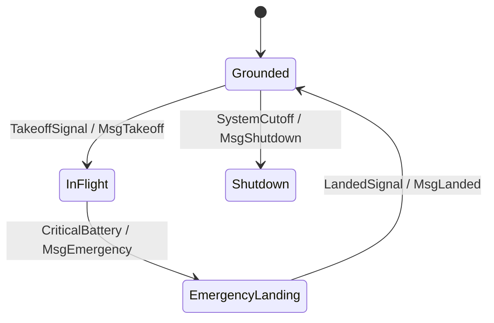
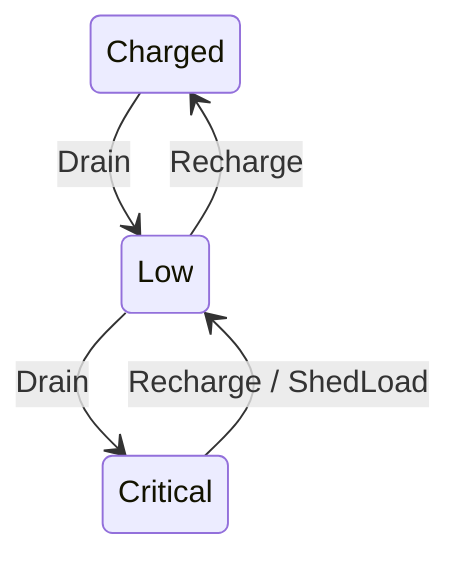
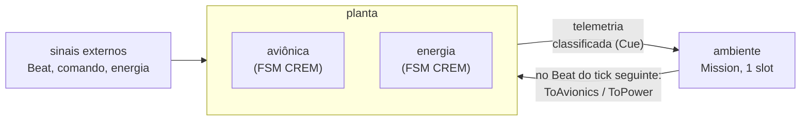

# avionics-crem

Máquina de estados finitos (FSM) da aviônica de um UAV, escrita em Haskell em quatro camadas de
rigor crescente, com um **simulador puro** em cima dela. O ponto central do projeto: usar a
biblioteca [CREM](https://hackage.haskell.org/package/crem) para que a *topologia* da FSM seja
verificada pelo compilador, e medir o que essa garantia cobre e o que ela não cobre.

Projeto de iniciação científica (PIC) da Fatec Rubens Lara.
Toolchain dos resultados documentados: GHC 9.6.7, cabal 3.12.1.0, `crem` 0.1.0.0,
`singletons-base` 3.2.

## Sumário

1. [A máquina](#a-máquina)
2. [As quatro camadas](#as-quatro-camadas)
3. [Início rápido](#início-rápido)
4. [O simulador](#o-simulador)
5. [Validação e testes](#validação-e-testes)
6. [Comparação com C e C++](#comparação-com-c-e-c)
7. [Estrutura do repositório](#estrutura-do-repositório)
8. [Documentação](#documentação)
9. [Limites do que foi feito](#limites-do-que-foi-feito)

## A máquina

Quatro estados e quatro eventos de entrada. Cada evento produz uma mensagem de saída; um par
(estado, evento) sem regra deixa o estado como está e emite `MsgIgnored` (convenção do projeto, não
dos requisitos).



A regra de domínio que motiva o projeto: **`InFlight → Shutdown` é explicitamente proibida**. Na
versão com CREM, tentar escrever essa transição não compila (ver
[`output/invalid_raw.txt`](output/invalid_raw.txt)). A especificação dessas regras, derivada do
texto dos requisitos e separada do código, está em [`spec/domain_rules.txt`](spec/domain_rules.txt).

Há ainda uma segunda máquina independente, a bateria (`Power`), que só se encontra com a
aviônica na composição:



## As quatro camadas

A mesma FSM é escrita quatro vezes, cada uma acrescentando uma garantia, e as versões são
comparadas entre si pelos testes.

| Camada | Módulo | O que traz |
|---|---|---|
| 1. Ingênua | [`Avionics.Naive`](src/Avionics/Naive.hs) | `AvState`, `AvEvent`, `transition` com os 16 pares escritos um a um, `runMealy`. O compilador avisa de um par omitido (`-Werror=incomplete-patterns` o torna erro). |
| 2. State Monad | [`Avionics.StateMonad`](src/Avionics/StateMonad.hs) | `ST`, composição de Kleisli (`>=>`), provas em comentário das leis de Monad, Functor e Applicative, e `lawChecks` que as confere por execução. |
| 3. CREM | [`Avionics.Crem`](src/Avionics/Crem.hs) | Vértices promovidos a tipos com `singletons`, topologia como valor de tipo, `avionicsAction` com `pureResult`. Uma transição fora da topologia é **erro de tipo**. |
| 4. Composição | [`Avionics.Power`](src/Avionics/Power.hs), [`Avionics.Compose`](src/Avionics/Compose.hs), [`Avionics.Diagram`](src/Avionics/Diagram.hs) | FSM de energia, `Parallel`, `Sequential` e `Alternative`, e diagramas Mermaid gerados pelo `Crem.Render`. |

O teste [`invalid/InvalidInFlightShutdown.hs`](invalid/InvalidInFlightShutdown.hs) **não compila de
propósito**: é a evidência de que o tipo recusa a transição proibida.

## Início rápido

Requisitos: GHC 9.6.7 e cabal 3.12.1.0 (versões usadas nos resultados documentados). Os scripts
`.sh` precisam de `bash` (no Windows, o Git Bash serve).

```bash
git clone https://github.com/0ph1s/avionics-crem.git
cd avionics-crem
cabal build                      # biblioteca e executáveis (não inclui o teste de invalidez)
cabal run avionics-crem          # camadas 1 a 4: traço, leis, composição; grava output/*.mmd
cabal run avionics-sim           # simulador: dois cenários em malha fechada
cabal test avionics-sim-tests    # suíte do simulador
```

Duas armadilhas conhecidas:

* **`cabal test` sem alvo falha**, porque também constrói `invalid-inflight-shutdown`, que não compila
  de propósito. Use sempre o nome da suíte.
* **`cabal build avionics-crem` é ambíguo** (a biblioteca e o executável têm o mesmo nome). Use
  `cabal build lib:avionics-crem` ou `cabal build all`.

Para ver a falha de invalidez:

```bash
cabal build invalid-inflight-shutdown --enable-tests   # falha: Could not deduce AllowedTransition
```

## O simulador

[`src/Avionics/Sim/`](src/Avionics/Sim) é um simulador **puro** (sem IO, sem aleatoriedade) da
composição aviônica + energia. Um *cenário* é uma lista de entradas, uma por tick, e o resultado é
um *traço* com o vértice de cada máquina em cada passo.

Duas formas de rodar o mesmo cenário:

* **Malha aberta**: a saída da aviônica não volta para lugar nenhum. É a composição do CREM
  observada passo a passo.
* **Malha fechada**: a saída da aviônica alimenta um *ambiente reativo* (a FSM `Mission`), que
  responde no **tick seguinte**, com a aviônica *e* com a energia. O laço é fechado com o
  construtor `Feedback` do CREM.



O atraso de um tick não vem de graça: o `Feedback` do CREM é instantâneo (reinjeta dentro do mesmo
`run`). Por isso a `Mission` funciona como um registrador de um slot: **retém** a telemetria e
**libera** no `Beat` seguinte.

| Telemetria da planta | O ambiente retém | E libera no tick seguinte |
|---|---|---|
| bateria `ReportCritical` | `CriticalHeld` | `CriticalBattery` para a aviônica |
| `MsgEmergency` | `TouchdownHeld` | `ShedLoad` para a energia **e depois** `LandedSignal` |
| `MsgLanded` | `CutoffHeld` | `SystemCutoff` para a aviônica |

### Exemplo: o cenário de emergência

O operador manda decolar e a bateria é esgotada. Sem ninguém mais comandar, o ambiente encadeia
emergência, pouso e corte, um passo por tick (saída real de `cabal run avionics-sim`, resumida):

| Tick | Entrada | Aviônica | Energia | Ambiente |
|---|---|---|---|---|
| 0 | `TakeoffSignal` | `Grounded → InFlight` | `Charged` | `Standby` |
| 1 | `Drain` | `InFlight` | `Charged → Low` | `Standby` |
| 2 | `Drain` | `InFlight` | `Low → Critical` | **retém** `CriticalHeld` |
| 3 | — | `InFlight → EmergencyLanding` | `Critical` | libera `CriticalBattery`; retém `TouchdownHeld` |
| 4 | — | `EmergencyLanding → Grounded` | `Critical → Low` (`ShedLoad`) | libera `ShedLoad` e `LandedSignal`; retém `CutoffHeld` |
| 5 | — | `Grounded → Shutdown` | `Low` | libera `SystemCutoff` |

Saídas da aviônica: `[MsgTakeoff, MsgEmergency, MsgLanded, MsgShutdown]`, estado final `Shutdown`.
O mesmo cenário em malha aberta termina em `InFlight` com a bateria em `Critical`: sem
realimentação, nada liga uma coisa à outra.

O executável grava os traços como diagramas de sequência Mermaid (`sim_trace_nominal.mmd`,
`sim_trace_emergencia.mmd`). Por padrão o destino é `../../Obsidian/documentation` se essa pasta
existir, e `output/` caso contrário. Para escolher a pasta:

```bash
cabal run avionics-sim -- caminho/da/pasta
```

O programa nunca sobrescreve um arquivo que não tenha sido gerado por ele (confere uma marca na
primeira linha).

### Módulos do simulador

| Módulo | Papel |
|---|---|
| `Scenario` | entrada por tick, alfabeto de sinais, cenários prontos e enumerações para os testes |
| `Observe` | observa o vértice de uma máquina CREM sem alterar sua lógica de transição |
| `Trace` | tipos do traço e `renderTrace` |
| `Plant` | aviônica e energia em paralelo, com vértice observado |
| `Mission` | o ambiente: FSM de um slot (`Standby`, `CriticalHeld`, `TouchdownHeld`, `CutoffHeld`) |
| `Loop` | fecha o laço com `Feedback` |
| `Simulate` | `simulate` (aberta) e `simulateClosed`, sobre a State Monad do projeto |
| `Properties` | propriedades verificadas sobre um traço |
| `Validate` | comparação com a FSM ingênua e com `Compose.uavSystem` |
| `Mermaid` | exportação do traço como diagrama de sequência |

A garantia de tipos do CREM é preservada: a observação lê o destino do `ActionResult` e o
reconstrói com a mesma prova de aresta permitida (`AllowedTransition`). As funções de transição não
usam curinga `_`, para que o compilador continue apontando casos omitidos.

## Validação e testes

Todas as verificações são **enumerações limitadas**, não provas: cobrem todas as sequências até o
tamanho N indicado, e nada além disso.

| Comando | O que confronta | Escopo |
|---|---|---|
| `cabal test avionics-sim-tests` | simulador x FSM ingênua; planta x `Compose.uavSystem`; propriedades do traço (`Shutdown` só depois de `Grounded`, `EmergencyLanding` só de `InFlight`, determinismo, causalidade, atraso de um tick); traços corrompidos à mão devem ser reprovados | 32 verificações, N = 4, até 168 421 cenários |
| `cabal test avionics-spec-tests` | topologia, FSM ingênua e ação do CREM x `spec/domain_rules.txt` | 16 verificações, exaustivo (4 estados x 4 eventos) |
| `bash scripts/negative_matrix.sh` | os 16 pares (origem, destino): 8 devem compilar, 8 devem ser rejeitados pelo GHC | 16 compilações |
| `cabal test avionics-chain-tests` | invariante da cadeia da bateria e descarte de telemetria do ambiente | N = 8, 87 381 cenários |
| `cabal test avionics-policy-tests` | ambiente reimplementado sem CREM (oráculo independente) e três políticas de ambiente | N = 8, 87 381 cenários |

Para saber se os próprios testes conseguem falhar, defeitos foram injetados de propósito (mutações)
e a reprovação conferida; os resultados, inclusive o caso em que o compilador **aceita** um defeito
(destino errado numa aresta permitida), estão em [`docs/conformidade.md`](docs/conformidade.md).

Achado registrado: a `Mission` reage à *borda* "a bateria entrou em `Critical`" e não ao *nível*.
Se o UAV decola com a bateria já crítica, nada o leva a emergência. A `Mission` não foi alterada
(é decisão de modelagem do autor); a política `Level`, que corrige isso, existe só no modelo de
referência.

## Comparação com C e C++

`compare-c/` reescreve a mesma FSM em C (`enum` e `switch`) e em C++ (`enum class`), com sete
variantes de defeito cada, e compara o que o compilador, um teste exaustivo e o sistema de tipos de
Haskell detectam.

```bash
bash compare-c/run.sh       # C
bash compare-c/run_cpp.sh   # C++
```

Os scripts usam o clang que acompanha o GHC. Conclusão resumida (tabela completa em
[`docs/conformidade.md`](docs/conformidade.md)): para este domínio finito, o teste exaustivo
detecta os mesmos defeitos que o tipo; o que o CREM antecipa é a detecção da transição proibida,
sem escrever o teste. Já o destino errado numa aresta permitida **nenhum compilador detecta**.

## Estrutura do repositório

```
avionics-crem.cabal      biblioteca, executáveis e test-suites
src/Avionics/            camadas 1 a 4: ingênua, State Monad, CREM, energia, composição, diagramas
src/Avionics/Sim/        simulador puro (cenário, traço, planta, ambiente, laço, propriedades)
app/                     executável avionics-crem (camadas 1 a 4)
app-sim/                 executável avionics-sim (demonstração do simulador)
test/                    Spec.hs (simulador), SpecDomain.hs, SpecChain.hs, SpecPolicy.hs
invalid/                 teste de invalidez (não compila de propósito)
spec/                    regras do domínio, derivadas do texto dos requisitos
scripts/                 negative_matrix.sh (matriz de rejeição em compilação)
compare-c/               a mesma FSM em C e C++, com variantes defeituosas
docs/                    simulador.md e conformidade.md
output/                  diagramas, logs e resultados gerados pelos executáveis e scripts
```

## Documentação

| Arquivo | Conteúdo |
|---|---|
| [`docs/simulador.md`](docs/simulador.md) | arquitetura, decisões de projeto, como rodar, resultados reais, limitações e pontos que pedem decisão do autor |
| [`docs/conformidade.md`](docs/conformidade.md) | conformidade com a especificação, matriz de rejeição, mutações, cadeia da bateria, comparação com C/C++ |
| [`spec/domain_rules.txt`](spec/domain_rules.txt) | regras do domínio e convenções de mundo fechado |

## Limites do que foi feito

Resumo honesto; o detalhe e os números estão nos documentos acima.

* **A garantia de tipos é por aresta, não por sequência.** `InFlight → EmergencyLanding →
  Grounded → Shutdown` é aceito, e é correto aresta a aresta.
* **O tipo aceita qualquer destino que seja aresta da topologia.** Associar o evento ao destino
  errado numa aresta permitida passa pelo compilador; quem pega é a especificação com eventos.
* **Validação por enumeração limitada** (N = 4 ou N = 8), não prova. O espaço além de N não foi
  explorado.
* **A especificação foi escrita pela mesma pessoa que escreveu o código.** É um artefato distinto,
  derivado de um texto anterior, mas não é um oráculo de terceiros.
* **O ambiente (`Mission`) e o evento `ShedLoad` são escolhas de modelagem**, não consequências
  físicas de nada. `ShedLoad` foi o único acréscimo a código preexistente (um construtor em
  `PowerEvent` e três cláusulas em `powerAction`).
* **Os tempos documentados são de uma máquina e de uma execução**; servem de ordem de grandeza.
