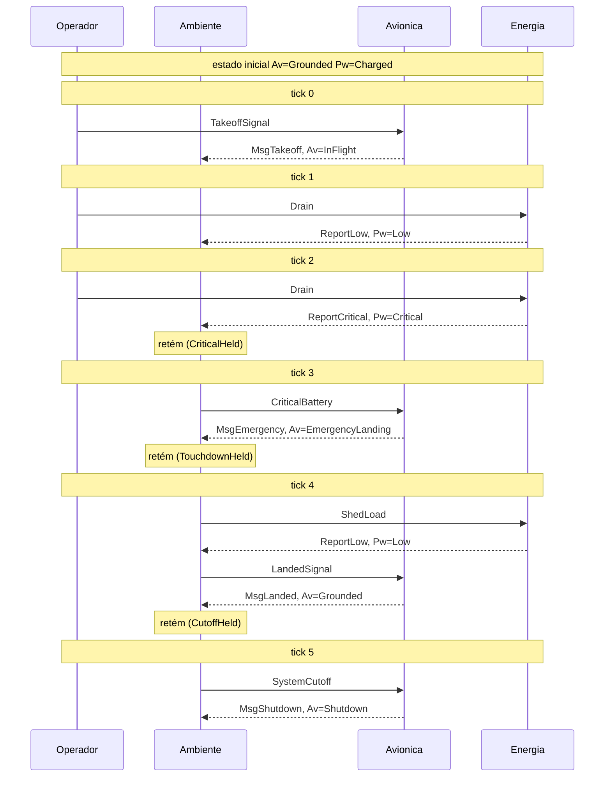

# Simulador puro da FSM de aviônica (`avionics-crem`)

Simulador ad-hoc, em Haskell puro, do sistema UAV visto como composição de FSMs. Valida o
comportamento **discreto** da máquina e da sua composição; não modela física de voo.

Toolchain usada em todos os resultados abaixo: GHC 9.6.7, cabal 3.12.1.0, `crem` 0.1.0.0,
`-O1`, Windows 11.

## 1. O que o simulador faz

Dado um cenário (uma entrada por tick) e um estado inicial, devolve um **traço**: por tick, a
entrada, os passos que cada máquina deu (evento recebido, saída emitida, vértice em que ficou).
Existem duas formas de executar o mesmo cenário:

| Função | Malha | O que acontece |
|---|---|---|
| `simulate` | aberta | cada máquina só recebe o que o cenário manda |
| `simulateClosed` | fechada | o ambiente realimenta a aviônica **com um tick de atraso**, via `Feedback` do CREM |

Sem IO, sem `unsafePerformIO`, sem `IORef`, sem aleatoriedade em nenhum módulo
`Avionics.Sim.*`. O único `IO` está em `app-sim/Main.hs` (imprimir e gravar diagramas) e em
`test/Spec.hs` (relógio e saída).

## 2. Arquitetura

```
 cenário ──► [Beat, cmd?, drain?]  (estímulos de um tick, em ordem)
                    │
                    ▼
        ┌──────────────────────── Feedback (CREM) ─────────────────────────┐
        │  caminho direto (StateMachineT Signal [LoopStep])                │
        │                                                                  │
        │  Signal ─► planta ──────────────► classify ─► Mission (FSM)      │
        │            Parallel(Aviônica,                  Standby           │
        │                     Energia)                   CriticalHeld      │
        │            cada folha é observada              TouchdownHeld     │
        │                                                CutoffHeld        │
        │                                                   │              │
        │  caminho de retorno (stateless): [Signal] ◄───────┘ (o que o     │
        │  ambiente liberou neste passo é reinjetado no Feedback)          │
        └───────────────────────────────┬──────────────────────────────────┘
                                        ▼
                         [LoopStep] ─► TraceStep ─► Trace
```

| Módulo | Papel |
|---|---|
| `Avionics.Sim.Scenario` | `TickInput`, `Signal`, `SimInit`, cenários prontos e enumerações de entradas |
| `Avionics.Sim.Observe` | `observedMachine`: embrulha uma ação do CREM para relatar o vértice |
| `Avionics.Sim.Plant` | aviônica e energia em `Parallel`, com `avionicsAction` e `powerAction` originais |
| `Avionics.Sim.Mission` | FSM do ambiente (4 vértices, topologia tipada, 20 casos sem curinga); libera `ShedLoad` e `LandedSignal` na emergência |
| `Avionics.Sim.Loop` | monta o `Feedback`; `classify` traduz telemetria em `Cue` |
| `Avionics.Sim.Simulate` | `simulate` e `simulateClosed`, encadeados com a `ST` do projeto |
| `Avionics.Sim.Trace` | `Trace`, `TraceStep`, `StepRecord`, `renderTrace` |
| `Avionics.Sim.Properties` | propriedades sobre o traço |
| `Avionics.Sim.Validate` | validação cruzada contra a FSM ingênua e contra `uavSystem` |
| `Avionics.Sim.Mermaid` | traço → `sequenceDiagram` |

A `ST` (State Monad de `Avionics.StateMonad`) carrega, de passo em passo, **a própria máquina
composta** como estado: `ST World [StepRecord]` consome a máquina de um estímulo e devolve a do
seguinte; `mapM` encadeia.

## 3. Decisões e motivos

**D1. O vértice é observado dentro da ação, não adivinhado.** Em `StateMachineT`, o construtor
`Basic` esconde o tipo de estado (é existencial), e o módulo `Render` do CREM só enxerga a
topologia. `observedMachine` recebe a mesma função de ação (por exemplo `avionicsAction`),
casa o `ActionResult` e lê o singleton de destino com `fromSing`. Nenhuma regra de transição foi
reescrita; e o `ActionResult` é reconstruído com a prova `AllowedTransition` do casamento de
padrão, então a garantia por aresta continua valendo.

**D2. `Feedback` existe e foi usado como previsto, mas é instantâneo.** Assinatura real
(`Crem.StateMachine`):

```haskell
Feedback :: (Foldable n, Monoid (n a), Monoid (n b))
         => StateMachineT m a (n b) -> StateMachineT m b (n a) -> StateMachineT m a (n b)
```

Aqui `n = []`, `a = Signal`, `b = LoopStep`. Não houve erro de tipo nem de kind; **não há
mensagem de compilador para citar, porque o construtor compilou de primeira.** O que difere do
pedido é a semântica de `run`: o laço é reiterado dentro do mesmo tick, até o caminho de retorno
parar de emitir. O pedido era "influenciar no tick **seguinte**". Em vez de trocar `Feedback`
por uma iteração própria, o atraso foi obtido dentro do modelo: a FSM de missão é um
registrador de um slot. Telemetria relevante a faz **reter** um evento (muda de vértice, não
emite); o `Beat` que abre o tick seguinte a faz **liberar** o evento retido. Isto é uma escolha
de modelagem minha; ver a seção 7.

**D3. O ambiente está no caminho direto, não no de retorno.** O `Feedback` só devolve ao chamador
o que o caminho direto emitiu. Com a FSM no retorno, o vértice dela ficaria dentro do laço e não
chegaria ao traço. O caminho de retorno é um `stateless` que só reinjeta o que a missão liberou.

**D4. A realimentação afeta o ambiente E a energia; a extensão é um evento novo em `Power`.**
O ambiente é a FSM nova `Mission` (`Standby | CriticalHeld | TouchdownHeld | CutoffHeld`), em
módulo novo. Para que a saída da aviônica também influencie a energia, acrescentei **um
construtor** a `PowerEvent`: `ShedLoad` (corte de cargas não essenciais numa emergência). Esta é
a única mudança em código existente do simulador inteiro, e é aditiva: um construtor e 3
cláusulas em `powerAction` (obrigatórias, porque o projeto compila com
`-Werror=incomplete-patterns`). A topologia de energia não mudou: `ShedLoad` só usa a aresta
`Critical -> Low`, que já existia. Nenhum outro código do projeto casa em `PowerEvent`
(conferido por busca).

Semântica de `ShedLoad`: com a bateria em `Critical` passa a `Low` (`ReportLow`); em `Low`
fica em `Low`; em `Charged` fica em `Charged`. Difere de `Recharge`, que em `Low` sobe até
`Charged`: cortar carga alivia a bateria crítica, mas não a recarrega.

| Telemetria | O ambiente retém | E libera no tick seguinte |
|---|---|---|
| bateria `ReportCritical` | `CriticalHeld` | `CriticalBattery` para a aviônica |
| `MsgEmergency` | `TouchdownHeld` | `ToPower ShedLoad` **e depois** `LandedSignal` (toque no solo) |
| `MsgLanded` | `CutoffHeld` | `SystemCutoff` (fim de missão) |

**D5. Terminação do laço.** A `Mission` só emite ao receber `CueBeat`, e o único `Beat` vem do
cenário. O que ela emite é `ToAvionics e` ou `ToPower e`, cuja telemetria nunca é `CueBeat`. Logo a
segunda iteração do `Feedback` não emite e o laço para. O `ShedLoad` também não reentra: o
relato dele (`ReportOk` ou `ReportLow`) nunca é `ReportCritical`. Este argumento está no código; não há guarda em
tempo de execução (o `Feedback` do CREM não oferece uma).

**D6. Sem dependências novas.** Biblioteca: `base`, `crem`, `singletons-base`, `text` (as já
existentes). Executável: `base`, `avionics-crem`, `directory` (já usada pelo executável
original). Testes: `base`, `avionics-crem`, `crem`, `singletons-base`; tempo via `GHC.Clock`.
Sem QuickCheck.

## 4. Como rodar

```bash
cabal build                              # biblioteca e executáveis (não inclui testes)
cabal test avionics-sim-tests            # suíte do simulador (N = 4)
cabal test avionics-sim-tests --test-options=5    # outro comprimento máximo
cabal run avionics-sim                   # 2 cenários; grava diagramas em ../../Obsidian/documentation
cabal run avionics-sim -- <pasta>        # grava em outra pasta
cabal build invalid-inflight-shutdown --enable-tests   # falha de propósito, como antes
```

**Atenção:** `cabal test` **sem alvo** falha, porque também tenta construir
`invalid-inflight-shutdown`, que não compila de propósito. Isto já era assim antes do
simulador (conferido na linha de base). Use sempre `cabal test avionics-sim-tests`.

## 5. Resultados reais

### 5.1 Compilação

Recompilação completa da biblioteca (16 módulos, os 6 originais mais os 10 novos), dos
executáveis `avionics-crem` e `avionics-sim` e da suíte (19 compilações, refeita depois do `ShedLoad`), com `-Wall -Werror=incomplete-patterns`: saída 0, **nenhuma
linha de aviso ou erro**. Nenhum `_` curinga nas funções de transição e de ação
(`missionAction`, `powerAction`, `avCue`, `powCue`, `signalToPair`, `naiveVertex`, `expectedRelease`, `level`).
Há `_` em código auxiliar que não é transição nem ação: dobras (`foldl (\_ s -> ...)`), casos
base de recursão (`go _ []`) e o caso padrão de dois `case` em `Avionics.Sim.Mermaid`.

### 5.2 Suíte `avionics-sim-tests` (N = 4)

32 verificações, 0 falhas. Tempos nesta máquina:

| Verificação | Cenários | Tempo |
|---|---|---|
| malha aberta == FSM ingênua (saídas e estado final) | 341 | 0,0 s |
| malha aberta, repetição passo a passo na ingênua | 341 | 0,0 s |
| malha fechada, só comandos, eventos recebidos repetidos na ingênua | 341 | 0,01 s |
| malha fechada, alfabeto completo (20 símbolos de tick), idem | 168 421 | 7,63 s |
| planta observada == `Compose.uavSystem` | 22 621 | 0,16 s |
| `Shutdown` só depois de `Grounded` (aberta / fechada) | 168 421 | 0,52 s / 7,48 s |
| entrada em `EmergencyLanding` só vinda de `InFlight` (aberta / fechada) | 168 421 | 0,52 s / 7,49 s |
| `ShedLoad` nunca reduz o nível da bateria (aberta / fechada) | 168 421 | 0,49 s / 7,21 s |
| determinismo (aberta / fechada) | 168 421 | 0,75 s / 8,36 s |
| causalidade: traço do prefixo é prefixo do traço (aberta / fechada) | 8 421 | 0,08 s / 0,91 s |
| o `Beat` libera exatamente o que foi retido no tick anterior | 168 421 | 7,46 s |

341 = 1 + 4 + 16 + 64 + 256 (sequências de comandos de até 4 eventos). Com N = 3 o mesmo cálculo
dá as 85 sequências da validação cruzada original do projeto (conferido com `--test-options=3`).
Em malha fechada compara-se a FSM ingênua com os eventos que a aviônica **recebeu de fato**
(inclusive os realimentados), porque o ambiente injeta eventos extras e a lista de comandos
sozinha não descreve a execução.

Como conferi que a contagem é trabalho real (e não laziness): antes de acrescentar o `ShedLoad`,
uma sonda independente somou 213 090 passos simulados em malha aberta e 546 022 em malha fechada
nos 54 241 cenários de então, com os 4 vértices da aviônica e os 3 da energia alcançados como
estado final. Não repeti a sonda com o alfabeto de 20 símbolos.

**Teste de mutação do próprio simulador** (feito com a suíte anterior, de 27 verificações, antes do `ShedLoad`; não repetido). Introduzi dois defeitos, um por vez, e restaurei os
arquivos (confirmado com `diff`):

| Defeito injetado | Verificações que falharam |
|---|---|
| `CriticalHeld` libera `LandedSignal` em vez de `CriticalBattery` | 4 de 27 |
| o observador relata o vértice de origem em vez do de destino | 9 de 27 |

E a seção D da suíte alimenta as propriedades com traços corrompidos à mão, para provar que elas
não são vacuamente verdadeiras.

### 5.3 Execução de referência

Decolagem, bateria crítica, pouso e corte reproduzem
`[MsgTakeoff, MsgEmergency, MsgLanded, MsgShutdown]`, com estado final `Shutdown`, de duas
formas: em malha aberta com os quatro comandos (idêntico à FSM ingênua) e em malha fechada com
**um** `TakeoffSignal` e dois `Drain`.

Em malha aberta o mesmo cenário de emergência termina com a bateria em `Critical` e a aviônica
ainda em `InFlight`: sem realimentação, nada liga uma coisa à outra. Em malha fechada a bateria
termina em `Low`, porque a emergência dispara o `ShedLoad`.

### 5.4 Traço em malha fechada (cenário de emergência)

Saída de `cabal run avionics-sim`, resumida às colunas que importam (o programa imprime também o
passo do relógio e o vértice do ambiente):

| Tick | Entrada | Passo | Aviônica | Energia | Ambiente |
|---|---|---|---|---|---|
| 0 | `TakeoffSignal` | operador | `MsgTakeoff` → `InFlight` | `Charged` | `Standby` |
| 1 | `Drain` | operador | `InFlight` | `ReportLow` → `Low` | `Standby` |
| 2 | `Drain` | operador | `InFlight` | `ReportCritical` → `Critical` | **retém** `CriticalHeld` |
| 3 | — | relógio libera `CriticalBattery`; laço | `MsgEmergency` → `EmergencyLanding` | `Critical` | retém `TouchdownHeld` |
| 4 | — | relógio libera `ShedLoad` e `LandedSignal`; laço | `MsgLanded` → `Grounded` | `ShedLoad`: `ReportLow` → `Low` | retém `CutoffHeld` |
| 5 | — | relógio libera `SystemCutoff`; laço | `MsgShutdown` → `Shutdown` | `Low` | `Standby` |

A bateria chega a `Critical` no tick 2 e o `MsgEmergency` sai no tick 3; o `ShedLoad` chega à
energia no tick 4, um tick depois do `MsgEmergency`. Os dois atrasos são verificados pela suíte.

Diagrama gerado (`Obsidian/documentation/sim_trace_emergencia.mmd`):



O cenário nominal está em `Obsidian/documentation/sim_trace_nominal.mmd`. Os `.mmd` anteriores
(`avionics_topology`, `power_topology`, `coupled_flow`) não foram tocados: o executável recusa
sobrescrever qualquer arquivo existente que não comece com a marca `%% gerado por avionics-sim`.

### 5.5 Garantia de tipos preservada

* `invalid-inflight-shutdown`: continua falhando com
  `Could not deduce AllowedTransition ... InFlight Shutdown` em `InvalidInFlightShutdown.hs:23`,
  exit 1, sem alteração no arquivo nem no seu `test-suite`.
* Transição proibida na FSM nova: um arquivo de teste (fora do projeto) com
  `TouchdownHeld -> CriticalHeld` foi rejeitado com
  `Could not deduce AllowedTransition ... TouchdownHeld CriticalHeld`.
* `ShedLoad` só usa a aresta `Critical -> Low` de `powerTopology`, que já existia; a topologia de
  energia não foi alterada e a suíte exige que ele nunca reduza o nível da bateria.
* Completude: removendo a cláusula `missionAction SCutoffHeld CueLanded` num arquivo de teste, o
  GHC acusa `[-Wincomplete-patterns, Werror=incomplete-patterns]` e aponta o par faltante.

## 6. Limitações

* **A garantia de tipos do CREM é por aresta.** Cada transição individual é verificada na
  compilação. As propriedades de **sequência** acima (`Shutdown` só depois de `Grounded`,
  `EmergencyLanding` só a partir de `InFlight`, atraso de um tick) são checadas por
  **enumeração limitada**, não provadas. Ausência de contraexemplo até N = 4 não é prova.
* **O evento que dispara a transição não faz parte do tipo do vértice.** O vértice é
  `SInFlight`, não "`InFlight` depois de `TakeoffSignal`". O tipo não distingue por que se chegou
  ali, e é por isso que o histórico precisa ser verificado no traço.
* **O simulador é discreto.** Não há física, tempo contínuo nem duração de tick. "Um tick de
  atraso" é uma contagem de passos de simulação, sem correspondência com segundos.
* **Diagramas Mermaid.** `sim_trace_nominal.mmd` e `sim_trace_emergencia.mmd` foram analisados e
  renderizados com Mermaid 10.9.1 (carregado de CDN) no navegador embutido do app: ambos
  retornaram SVG sem erro. Só conferi visualmente o diagrama nominal; o de emergência passou
  pelo parser sem erro, mas não olhei a imagem inteira. Os `.mmd` pré-existentes não foram
  re-renderizados por mim.
* **O diagrama de emergência foi regenerado depois do `ShedLoad` e não foi re-renderizado.** A
  renderização descrita acima é da versão anterior (sem a mensagem `Amb->>Pw: ShedLoad`, que usa
  a mesma sintaxe das demais).
* **N = 4 não alcança a cadeia completa de emergência induzida pela bateria.** Takeoff + dois
  `Drain` + três ticks de liberação exigem 6 ticks. Esse caminho é coberto apenas pelo cenário
  fixo da seção A da suíte, não pela enumeração. Pelos comandos, a cadeia de
  emergência→pouso→corte já é alcançada em 4 ticks (`TakeoffSignal`, `CriticalBattery`, e dois
  ticks ociosos).
* **Registrador de um slot.** Com o slot ocupado, nova telemetria é descartada ("quem chega
  primeiro fica"). Em cenários com eventos simultâneos o ambiente pode perder um sinal. No
  recorte N = 4 isso não produziu nenhuma divergência em relação à FSM ingênua, mas a validação
  não diz se o comportamento do ambiente é o desejável.
* **O ambiente começa sempre em `Standby`** (`SimInit` só tem os vértices da aviônica e da
  energia).
* **Determinismo é trivial em código puro.** A verificação existe como regressão; um traço igual
  a si mesmo não demonstra muito. A causalidade (prefixo) é o teste mais informativo dessa
  família.
* **O laço não tem guarda de terminação em tempo de execução.** Depende do argumento da D5; uma
  edição futura em `missionAction` que emita em resposta a um sinal realimentado poderia travar o
  `Feedback` (o `run` do CREM itera até o retorno ficar vazio).
* **`ShedLoad` não é consequência física de nada.** É um corte de carga com semântica discreta
  que escolhi; a ordem entre `ShedLoad` e `LandedSignal` na liberação é arbitrária (a ordem inversa
  também seria válida).
* **Tempos** são de uma máquina e de uma execução; servem de ordem de grandeza.

## 7. Pontos que pedem decisão do autor

1. **Atraso de um tick:** obtido por registrador + `Beat`, não pelo `Feedback` em si (que é
   instantâneo). Se preferir `Feedback` puro com efeito imediato, basta a `Mission` liberar na
   hora; se preferir um atraso maior, é só encadear mais retenções.
2. **`ShedLoad` e a semântica de "afetar a energia":** resolvido a seu pedido com um evento novo
   em `PowerEvent`. Fica a escolha da semântica (só sobe `Critical -> Low`), que é minha.
3. **A semântica do ambiente** (bateria crítica vira sensor, emergência vira toque no solo,
   pouso vira corte) é uma interpretação minha do domínio.
4. **Política de colisão** do slot ("quem chega primeiro fica") versus prioridade ou fila.
5. **`cabal test` sem alvo falha** por causa do `invalid-inflight-shutdown`. Dá para separar o
   teste de invalidez num pacote próprio ou documentar o alvo explícito (feito aqui).

## 8. O que foi alterado em arquivos existentes

Somente aditivo. A única alteração em código existente é a do `ShedLoad`:

* `src/Avionics/Power.hs`: construtor `ShedLoad` em `PowerEvent` e 3 cláusulas em `powerAction`
  (justificativa na D4). O executável original e o teste de invalidez continuam como antes.
* `avionics-crem.cabal`: 10 módulos novos em `exposed-modules`, um `executable avionics-sim` e um
  `test-suite avionics-sim-tests`. O stanza de `invalid-inflight-shutdown` não foi tocado.
* `README.md`: uma seção apontando para este documento.

Arquivos novos: `src/Avionics/Sim/*.hs` (10), `app-sim/Main.hs`, `test/Spec.hs`,
`docs/simulador.md`, e em `Obsidian/documentation/`: `sim_trace_nominal.mmd`,
`sim_trace_emergencia.mmd`.
